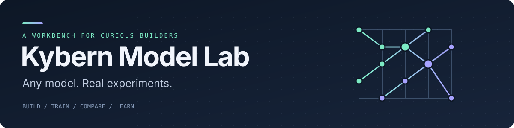

<p align="center">
  
</p>

<p align="center">
  <a href="https://github.com/supernovae/model-lab/actions/workflows/ci.yml"></a>
  <a href="pyproject.toml"></a>
  <a href="LICENSE"></a>
</p>

<p align="center">
  <a href="docs/build.md">Build a model</a> ·
  <a href="docs/lab-mode.md">Test a change</a> ·
  <a href="docs/README.md">All guides</a>
</p>

Kybern Model Lab (`klab` on the command line) is a workbench for building and
studying language models. You describe a model, its data and its training in
YAML, and Lab prepares the data, trains, evaluates and keeps a verifiable record
of every run. When you want to know whether a change helps, Lab trains it
against a baseline on the same data and shows you what moved: held-out loss,
behavioral probes, generations and the weights themselves.

Lab builds dense, mixture-of-experts, memory-augmented and sparse-attention
decoders, from a CPU smoke test to a long multi-GPU run, and takes them through
instruction tuning, distillation, preference tuning and export to Hugging Face.

## Install

You need Python 3.14 and [uv](https://docs.astral.sh/uv/).

```sh
git clone https://github.com/supernovae/model-lab.git
cd model-lab
uv sync --locked --extra cpu --dev
. .venv/bin/activate
export KLAB_WORK_DIR="$HOME/.local/share/klab"
```

This works on Linux, WSL2 and macOS. Activate `.venv` in each new terminal, or
run `.venv/bin/klab` directly. `KLAB_WORK_DIR` is where Lab keeps corpora,
prepared data, runs and records; it should live outside the checkout.

`--extra cpu` installs PyTorch. It does not decide where a model runs: that is
the config's `runtime.backend`. For a GPU, set up its environment once with the
[runtime guide](docs/runtime.md). To run without a local Python, use the
[container images](docs/containers.md). Add `--extra pdf` to acquire PDF corpus
sources ([source kinds](docs/corpus-preparation.md#source-kinds)).

## Build a model

Five commands turn a text corpus into a model you can sample from. Start from
the example, then swap in your own files:

```sh
cp -r examples/build-local-text "$KLAB_WORK_DIR/my-model"
cd "$KLAB_WORK_DIR/my-model"
klab tokenizer train tokenizer.yaml
klab inspect model.yaml
klab data prepare model.yaml
klab train model.yaml --run-id first
klab generate first --runs-dir work/runs --prompt "The baker counts"
```

The [build guide](docs/build.md) explains each step and the fields to change
for your corpus, model size and hardware.

## Test a change

Write the change as a small file and compare it with a baseline:

```sh
cat > wider-ffn.yaml <<'YAML'
question: Does a wider feed-forward help at the same token budget?
set:
  model.ffn_dim: 384
YAML
klab try wider-ffn.yaml --vs model.yaml
klab report TRY_ID
```

`try` trains both arms on the same data, scores them on the same held-out
split, runs a fast set of behavioral probes and writes one record. `report`
reads it back. The [lab mode guide](docs/lab-mode.md) covers seeds, probe tiers
and resource limits.

| Question | Command |
| --- | --- |
| Does this change help? | `klab try DELTA.yaml --vs BASELINE.yaml` |
| What happened? | `klab report TRY_ID` |
| How does it behave on deeper checks? | `klab probe TRY_ID --config standard` |
| How does it compare with other results and public models? | `klab compare TRY_ID --references` |
| What is going on inside the weights? | `klab explore TRY_ID` |
| Can I look at it all in a browser? | `klab dashboard` |


## Hardware

| Hardware | Engine and backend |
| --- | --- |
| CPU | PyTorch, `cpu` |
| NVIDIA GPU | PyTorch, `cuda` |
| AMD GPU | PyTorch, `rocm` |
| Intel GPU | PyTorch, `xpu` ([setup](docs/intel-xpu.md)) |
| Apple Silicon | PyTorch, `mps`; or the MLX engine, `metal` ([setup](docs/macos-mlx.md)) |

A run uses one host. Several GPUs on that host can share one run, and the
[worker queue](docs/workers.md) runs independent jobs on other machines.

## What Lab covers

| Area | What you get | Guide |
| --- | --- | --- |
| Architecture | Dense, grouped-query, sliding-window, sparse long-context and latent attention; mixture-of-experts; n-gram and byte memory tables; named presets scaled to a parameter count; parts from your own packages | [Architecture](docs/architecture.md) |
| Data | Local text and chat, pinned Hugging Face datasets, a reusable binary token store, and corpus preparation for 10B+ token mixtures | [Datasets](docs/datasets.md) |
| Training | Checkpoints you can verify, resume and promote; memory planning; activation recomputation and offload; several GPUs per host | [Training](docs/training.md) |
| Post-training | Instruction tuning, distillation, preference optimization, chat templates and Hugging Face export | [Post-training](docs/post-training.md) |
| Evaluation | Held-out loss, probe tiers with verdicts, standard benchmarks, comparison with public reference models | [Probes](docs/probes.md) |
| Inspection | Per-token loss, attention maps, expert routing, memory lookups, chat, a local HTTP API and a dashboard | [Models](docs/models.md) |
| Scheduling | Independent runs, matrices and worker queues on local machines, Colab or rented GPUs | [Experiments](docs/experiments.md) |

## Where models live

Lab is the engine. A model's declarations can live in any Git repository: clone
it, `cd` into the project and run `klab`. [Kybern
Workshop](https://github.com/supernovae/kybern-workshop) holds the projects
Kybern runs, ready to copy. See [keeping a model in its own
repository](docs/build.md#4-keep-the-model-in-its-own-repository).

## Contributing

Read [CONTRIBUTING.md](CONTRIBUTING.md). Planned work is in the
[roadmap](ROADMAP.md) and in [GitHub issues](https://github.com/supernovae/model-lab/issues).
Agents working in this repository follow [AGENTS.md](AGENTS.md).

Lab is [MIT licensed](LICENSE). Datasets keep their own licenses.
