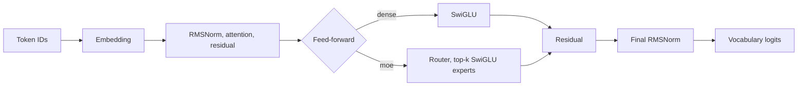

# Architecture

Lab builds causal decoders. The dense baseline uses RMSNorm, rotary position
embeddings (RoPE), causal attention, a SwiGLU feed-forward, residual connections
and a tied or untied output head. Each block's attention and feed-forward can be
swapped independently, and a memory table can be added to the model. This page
describes the mechanisms Lab ships; [model components](components.md) covers
choosing them per layer, scaling a named preset to a parameter count and adding
your own.



RMSNorm rescales a vector by its root mean square. RoPE rotates adjacent query
and key pairs by position, so their dot product depends on relative distance. A
causal mask keeps every position from seeing later ones. SwiGLU computes
`down(silu(gate(x)) * up(x))`. With `model.tie_embeddings`, the output head
reuses the input embedding.

## Attention

`attention.kind` selects the attention for every block. All of them keep causal
masking and RoPE, and none allocates a `[max_seq_len, max_seq_len]` buffer, so a
large configured context costs nothing until a sequence that long runs.

| Kind | What it does |
| --- | --- |
| `dense` | Full causal attention. `attention.implementation: sdpa` uses the backend's fused kernel. |
| `sliding_window` | Each position sees the last `window_size` positions. Work and memory grow with `T × window_size`. |
| `block_sparse` | Keys are grouped into blocks; each query scores block summaries and attends to the selected blocks. |
| `local_selected` | Long-context attention: a local window plus earlier blocks selected per head. See [sparse attention](sparse-attention.md). |
| `mla` | Multi-head latent attention: keys and values pass through a smaller latent width (`attention.latent_dim`). |

### Grouped-query attention

For `dense` and `sliding_window`, `model.num_kv_heads` (a divisor of
`num_heads`) shares each key/value head among a group of query heads. Queries and
the output keep full width; keys, values and the generation cache use
`num_kv_heads × head_dim`. Repeated keys and values are never materialized.
`mla`, `block_sparse` and the MLX engine require equal head counts.

### Block-sparse attention

`block_sparse` scores compressed block keys, then gathers the original keys and
values from the `selected_blocks` chosen per query, keeping the causal mask. On
ROCm it uses native HIP kernels over the selected keys; MLX has equivalent Metal
kernels; other devices use a reference implementation. Training logs how many
keys were available and selected.

### Latent attention

`mla` compresses each hidden state to `latent_dim`, expands keys from the latent
for RoPE scoring and keeps head-partitioned latent values, then projects back to
hidden width. `latent_dim` must divide evenly across heads. With
`implementation: sdpa` it uses the fused kernel. `local_selected` also accepts
`latent_dim`, combining latent keys and values with sparse selection.

### Generation cache

Generation with dense, grouped-query, sliding-window, latent and
`local_selected` attention uses an incremental key/value cache that lives for one
request; with grouped-query attention it stores only the key/value heads.
`generate(..., use_cache=False)` recomputes the full prefix instead, which is
also what attention kinds without a cache do.

## Feed-forward

`model.ffn` selects the feed-forward for every block: `dense` (SwiGLU) or `moe`.

### Mixture of experts

`moe` replaces the SwiGLU with `model.num_experts` independent SwiGLU experts.
The router computes `softmax(W x)`, keeps the `model.experts_per_token` largest
probabilities, renormalizes them and sums the selected experts' outputs:

$$y = \sum_{e \in \operatorname{TopK}(p)} \frac{p_e}{\sum_{j \in \operatorname{TopK}(p)} p_j} E_e(x)$$

- **Shared expert.** `model.shared_expert: true` adds a dense SwiGLU that every
  token uses.
- **Load balancing.** `model.router_aux_loss_coefficient` adds the auxiliary
  term $E\sum_e \bar p_e \bar l_e$, where $\bar p$ is the mean router
  probability and $\bar l$ the selected-token load.
- **Logged per update:** the auxiliary loss, router entropy, maximum expert
  share and mean selected probability.
- **Not implemented:** capacity limits, dropped tokens and expert parallelism.
  Every token reaches its experts on one device.

## Memory tables

`model.memory` adds a learned lookup table (Engram memory). `ngram` hashes the
last few token IDs at each position into the table, `byte` hashes the last few
UTF-8 bytes, and `portable` attaches a frozen table exported from another run.
At position `t` the address uses inputs up to `t` only, so it never reads the
target. See [Engram memory](engram.md).

## Combining mechanisms

Attention, feed-forward and memory choices are independent: any attention kind
works with `dense` or `moe`, with or without memory, and `model.layers` varies
attention and feed-forward by block. `configs/smoke_combined_cpu.yaml` combines
latent attention, mixture of experts and byte memory in one small model.

The MLX engine supports a subset: FP32 dense feed-forward models with `dense` or
`block_sparse` attention. See [MLX on Apple Silicon](macos-mlx.md).

## Parameter accounting

`klab inspect CONFIG` reports the parameter inventory and a memory estimate
without allocating the model.

- **`total`** counts every parameter tensor once. **`trainable`** is the subset
  that receives updates.
- **`active_per_token`** counts the weights one token uses. For a tied dense
  model that is everything; untied models count one input-embedding row. For
  mixture of experts it counts the router, the selected experts and any shared
  expert. It is a convention, not a FLOPs count.
- **Categories:** `embedding` holds tied output storage, so `output_head` is zero
  when embeddings are tied. `expert` holds all routed experts. A memory table,
  its projection and gate count as memory.

The dense presets in `configs/` at an 8,192-token vocabulary:

| Config | Parameters |
| --- | --- |
| `micro_dense.yaml` | 3,344,064 |
| `dense_7m.yaml` | 6,917,376 |
| `dense_10m.yaml` | 10,244,160 |
| `dense_25m.yaml` | 29,893,120 |
| `dense_50m.yaml` | 50,274,752 |

## Explore a mechanism before training

`klab learn` walks through one mechanism at a time, with no run store:

```sh
klab learn list
klab learn describe moe
klab learn scaffold moe --scale smoke --data offline --backend cpu --output "$KLAB_WORK_DIR/learn-moe"
klab learn probe "$KLAB_WORK_DIR/learn-moe/model.yaml" --prompt "Once upon a time"
```

`describe` shows each step's tensor shapes and the source that implements it.
`scaffold` writes a small runnable tokenizer and model config. `probe` runs a
freshly initialized model on CPU and reports the mechanism's shapes and
diagnostics; it says nothing about a trained model.

## References

| Mechanism | Paper |
| --- | --- |
| RMSNorm, RoPE, SwiGLU in a decoder | [LLaMA](https://arxiv.org/abs/2302.13971), [RoFormer](https://arxiv.org/abs/2104.09864), [RMSNorm](https://arxiv.org/abs/1910.07467), [SwiGLU](https://arxiv.org/abs/2002.05202) |
| Routed experts | [Switch Transformers](https://arxiv.org/abs/2101.03961) |
| Latent attention | [DeepSeek-V2](https://arxiv.org/abs/2405.04434) |
| Compressed, selected and local attention | [Native Sparse Attention](https://arxiv.org/abs/2502.11089) |
| N-gram lookup memory | [Engram](https://arxiv.org/abs/2601.07372) |
| Byte-addressed memory | [Tokenizer-Agnostic Engram](https://arxiv.org/abs/2607.29065) |
| Factored optimizer state | [Adafactor](https://arxiv.org/abs/1804.04235) |
